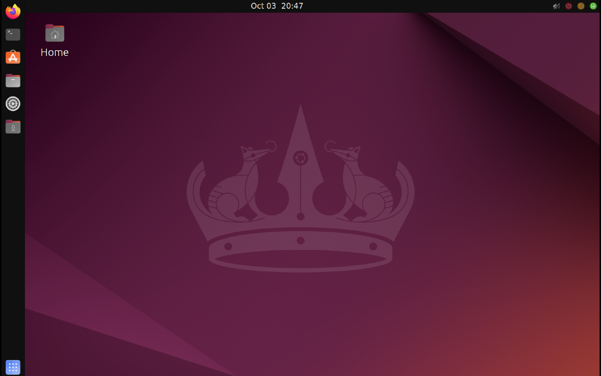

# ⚡ UbRoid — Ubuntu 24.04 LTS (Noble Numbat) for Android

<p align="center">
  
</p>

<p align="center">
  <b>Nikmati pengalaman Desktop Ubuntu 24.04 LTS yang otentik, stabil, dan siap pakai langsung di tablet & ponsel Android Anda.</b><br>
  <i>Lengkap dengan dock kiri khas Ubuntu, wallpaper resmi Noble Numbat, scaling 1.75x proporsional, 0% flickering, dan launcher native 1-tap Android.</i>
</p>

<p align="center">
  
  
  
  
  
</p>

---

## 🌟 Fitur Utama (Key Highlights)

- 📱 **Dual UI Mode (Ubuntu Desktop vs Ubuntu Touch Mobile)**:
  - 🖥️ **Ubuntu Desktop Edition**: Dock horizontal melayang di bawah, orientasi Landscape, ideal untuk tablet besar, monitor eksternal, dan penggunaan keyboard-mouse fisik.
  - 📱 **Ubuntu Touch Mobile Edition (Khusus POCO F6 / Smartphone)**: Terinspirasi langsung dari antarmuka mobile **[Ubuntu Touch (Lomiri)](https://www.ubuntu-touch.io/)** dengan **launcher vertikal di sisi kiri (68px Suru squircle)**, orientasi terkunci **PORTRAIT (vertikal)** ramah jempol, navigasi single-tap, touch scrollbar tebal 26px, skala 170 DPI proporsional, dan wallpaper resmi aubergine warm UBports (bebas dari wallpaper tikus XFCE). Sangat ideal untuk layar smartphone seperti **Xiaomi POCO F6**!
- 🚀 **Dual Launch Experience (APK Launcher vs Termux CLI)**:
  - ⚡ **Buka via APK Launcher (`Ubuntu_Launcher.apk`) — Dedicated OS Mode (Meninggalkan Android)**: Sekali tap icon Ubuntu di homescreen Android, sistem otomatis membekukan (*suspend*) aplikasi Android pihak ketiga di background via ADB, membebaskan 1.5 GB s/d 2.5 GB RAM, menyembunyikan garis gesture Android, dan mengaktifkan DND sehingga HP Anda 100% beralih menjadi Mini PC Ubuntu murni. Saat sesi ditutup, Android pulih normal seketika.
  - 🪶 **Buka via Termux CLI (`ubuntu` / `u`) — Lightweight Co-existence Mode**: Membuka antarmuka desktop/touch secara cepat dan ringan tanpa membekukan Android, sehingga Anda tetap dapat menerima notifikasi WhatsApp, panggilan telepon, dan multitasking bersama aplikasi Android lainnya.
- 🔄 **1-Command Permanent Mode Switcher**:
  - `touch-mode` (atau `switch-touch`): Beralih ke **Ubuntu Touch Mobile Edition** secara permanen.
  - `desktop-mode` (atau `switch-desktop`): Beralih ke **Ubuntu Desktop Edition** secara permanen.
- 🎙️ **Akses Hardware Penuh (Mini PC Replacement)**:
  - 🎤 **Audio Input / Microphone Capture**: Jembatan input mikrofon Android via PulseAudio OpenSL ES (`--load="module-sles-source"`), siap untuk recording, meeting, dan speech AI.
  - 📷 **Kamera V4L2 Qualcomm Snapdragon**: Node kamera ISP Snapdragon (`/dev/video*`) dibinding langsung ke dalam container Ubuntu.
  - 🗄️ **Penyimpanan Tak Terbatas**: Akses penuh ke seluruh internal storage `/sdcard`, `/storage/emulated/0`, dan `/root/Android_Storage`.
  - 🛡️ **Izin Android Komprehensif**: Kamera, Mikrofon, Full Storage (All Files), Lokasi, System Alert Window, dan Background AppOps telah diizinkan permanen.
- 🔌 **Permanent Wireless ADB Connectivity**:
  - Port statis `5555` dikunci permanen (`setprop service.adb.tcp.port 5555`).
  - Dilengkapi script 1-klik PC `scripts/connect-poco.ps1` dan `scripts/connect-poco.cmd` yang menghubungkan PC ke HP secara instan lewat jaringan Tailscale (`100.116.82.70:5555`) tanpa perlu pairing ulang atau kode verifikasi lagi.
- ⏳ **Pemilihan Mode Otomatis 5 Detik**: Saat instalasi, pengguna diberikan pilihan interaktif antara Desktop atau Ubuntu Touch. Jika tidak ada input selama 5 detik, sistem otomatis memilih **Ubuntu Desktop**.
- ⌨️ **Pengalaman Mengetik Fleksibel (Gboard & Onboard Auto-Popup)**:
  - **Android Gboard**: Cukup usap ke atas (*swipe up*) dari sisi bawah layar HP atau tekan tombol Back untuk langsung memunculkan keyboard bawaan Android (Gboard).
  - **Ubuntu Touch Onboard**: Keyboard virtual sentuh otomatis muncul (*auto-popup*) saat kolom teks/terminal disentuh, dan otomatis melipat saat selesai.
  - Tombol pintas keyboard virtual 1-tap di panel launcher dan status bar atas.
- 🐍 **Python Mobile Studio & Mini PC Mode**: Dilengkapi folder kerja `/root/Python_Workspace`, script pembuka interaktif, dan shortcut desktop `python-mobile` yang langsung membuka REPL Python 3.12 untuk mengubah HP Anda menjadi mini PC coding yang portabel!
- 🎨 **Tampilan Otentik Ubuntu**: Wallpaper resmi **Ubuntu Touch (UBports Lomiri)** ungu aubergine warm untuk smartphone & **Noble Numbat** ungu mascot untuk mode desktop, tema Yaru-dark, dan font Ubuntu yang tajam.
- 🚀 **Dock Bawah Melayang & Live Tasklist**: Dock autohide melayang (mengambang di atas navigation gesture bar Android) dengan pemisah vertikal elegan, pinned apps, dan **indikator tab jendela aktif live** (seperti Terminator, Browser, File Manager) lengkap dengan highlight garis oranye Ubuntu.
- ⚡ **Status Bar Atas Lengkap & Jam Presisi di Tengah**: Panel atas 36px dengan jam otomatis presisi di tengah layar (dynamic spacer) serta 8 icon utilitas lengkap di sebelah kanan:
  1. 🪟 **Snap Layout Helper**: Pilihan tata letak split-screen & kuadran cepat.
  2. 🖥️ **Dock Toggle**: Tampilkan / sembunyikan dock dengan 1 klik.
  3. ⌨️ **On-screen Keyboard**: Toggle cepat keyboard virtual Onboard.
  4. 📶 **Wi-Fi Manager**: Status sinyal live & dialog koneksi Wi-Fi GTK3.
  5. ᛒ **Bluetooth Manager**: Status & dialog pengaturan Bluetooth.
  6. 🔊 **Volume Control**: Slider volume audio cepat via dialog GTK3.
  7. 🔋 **Live Battery Status**: Indikator baterai real-time menampilkan persentase teks, status charging (⚡), warna dinamis, dan dialog info baterai (suhu, voltase).
  8. ⏻ **Power Menu**: Dialog logout, restart, dan shutdown bersih.
- 🛠️ **Native Interceptor (`libnogap.c`)**: Interceptor C level GTK untuk meniadakan window resize gaps pada terminal, mengunci posisi floating dock di atas Android navigation bar, dan merapikan layout panel.
- 🛡️ **Anti-Freeze & Anti-LMK Protection**: Dilengkapi `ram-guardian` dan `perf-governor` otomatis untuk menjaga multitasking tetap lancar tanpa terhenti oleh sistem Android.
- 📱 **Launcher Native 1-Tap (`Ubuntu_Launcher.apk`)**: Cukup tap icon Ubuntu di homescreen Android Anda, sesi Ubuntu akan otomatis berjalan di background dan langsung membuka desktop tanpa perlu membuka terminal Termux manual.
- 📁 **Integrasi Penyimpanan Internal Android**: Akses langsung folder `/sdcard`, Download, dan foto tablet melalui shortcut **Android Storage** di file manager Thunar.
- ℹ️ **Dialog Tentang UbRoid & Info Sistem (`dialog-about`)**: Dialog informasi GTK3 modern dan CLI (`about`) yang menampilkan model perangkat aktif (misal POCO F6 atau Redmi Pad 2), arsitektur CPU, resolusi layar, pemakaian RAM, dan identitas pengembang DetronicsID.

---

## 📦 Isi Folder Repository

```
UbRoid_TriWahyu45/
├── install.sh                     # Installer otomatis 1-klik (dijalankan di dalam PRoot Ubuntu)
├── bin/                           # Daemon & helper scripts (/usr/local/bin)
│   ├── status-bar-daemon          # Daemon live baterai & icon status
│   ├── dialog-battery             # Dialog pop-up status baterai GTK3
│   ├── dialog-wifi                # Dialog Wi-Fi GTK3
│   ├── dialog-bluetooth           # Dialog Bluetooth GTK3
│   ├── dialog-volume              # Dialog Volume slider GTK3
│   ├── snap-layout                # Menu snap layout jendela
│   ├── ram-guardian               # Anti-LMK memory guardian
│   └── perf-governor              # Pengatur performa & multi-core affinity
├── src/                           # Native C hooks
│   ├── libnogap.c                 # Hook geometry window, floating dock, & arrow suppression
│   └── Makefile                   # Build script libnogap.so
├── configs/                       # Konfigurasi desktop siap pakai
│   ├── xfce4-panel.xml            # Top Bar & Floating Dock
│   ├── xfwm4.xml                  # Window Manager anti-glitch
│   ├── xsettings.xml              # Scaling DPI & Tema Yaru-dark
│   ├── xfce4-desktop.xml          # Background wallpaper Ubuntu ungu
│   ├── gtk.css                    # Styling dock & active window tabs
│   ├── autostart/                 # Autostart status-bar-daemon
│   └── panel_launchers/           # Shortcut launchers & icon dock
├── scripts/
│   ├── setup_ubroid.sh            # Script instalasi lengkap dari Termux
│   ├── launch_ubuntu.sh           # Peluncur sesi Termux -> Termux-X11
│   ├── start_desktop.sh           # Inisialisasi sesi desktop di PRoot
│   └── shutdown_ubuntu.sh         # Skrip mematikan sesi dengan bersih
├── apks/                          # APK pendukung siap install
│   ├── Ubuntu_Launcher.apk        # Peluncur 1-Tap native Android
│   ├── termux-app.apk             # Termux base build teruji
│   └── termux-x11.apk             # Display server X11 untuk Android
└── assets/
    ├── wallpapers/                # Wallpaper resmi Ubuntu Noble Numbat
    ├── icons/                     # Vector icons resmi Firefox & Chrome
    └── screenshots/               # Screenshot preview desktop, top bar, & dock
```

---

## 🚀 Cara Instalasi Cepat (Otomatis 1 Baris)

> [!IMPORTANT]
> **Penting Mengenai Versi Termux:**
> Pastikan Anda menggunakan Termux versi **F-Droid atau GitHub** (file APK siap pasang [`termux-app.apk`](apks/termux-app.apk) sudah kami sediakan di dalam folder `apks/`).
> **JANGAN gunakan Termux dari Google Play Store**, karena versi Play Store sudah usang (*deprecated*) dan fiturnya dibatasi oleh Google sehingga shortcut peluncur 1-tap (`Ubuntu_Launcher.apk`) tidak dapat memanggil perintah otomatis.

> [!TIP]
> **Cara Cepat Menyalin:** Di GitHub, arahkan kursor atau tap pada kotak hitam di bawah, lalu klik icon **📋 (Copy)** di pojok kanan atas kotak perintah untuk menyalin secara instan.

Buka aplikasi **Termux**, lalu tempel (*paste*) perintah berikut:

```bash
curl -sL https://raw.githubusercontent.com/triwahyu45/UbRoid_TriWahyu45/main/ubroid.sh | bash
```

*Atau jika ingin meng-clone repositori terlebih dahulu:*
```bash
git clone https://github.com/triwahyu45/UbRoid_TriWahyu45.git && cd UbRoid_TriWahyu45 && bash ubroid.sh
```

Script akan otomatis:
1. Memeriksa izin penyimpanan (`termux-setup-storage`) & membersihkan terminal (`~/.hushlogin`).
2. Memperbarui paket Termux & memasang dependensi (`proot-distro`, `x11-repo`, `pulseaudio`, `bc`, dll.).
3. Mengunduh dan memasang container resmi **Ubuntu 24.04 LTS (Noble Numbat)** dengan tag versi terkunci.
4. Memasang XFCE4, Firefox PPA asli (bukan snap), tema Yaru-dark, font Ubuntu, dan dependensi desktop.
5. Menyiapkan Antigravity CLI (`agy`) Turbo Mode dan shortcut desktop resmi.
6. Menyalin file APK pendukung secara otomatis ke folder internal:
   📁 **`/sdcard/Download/UbRoid_APKs/`**
7. Mendeteksi resolusi dan DPI layar Android secara dinamis (menyesuaikan skala tampilan baik di Ponsel maupun Tablet).
8. Mengonfigurasi terminal Termux dan Ubuntu dengan **DetronicsID Terminal Welcome Banner** interaktif.

### Langkah 2: Pasang APK Pendukung dari Folder Download
Buka aplikasi **File Manager** bawaan Android Anda:
1. Masuk ke folder **Download** -> **`UbRoid_APKs`**.
2. Pasang kedua aplikasi pendukung:
   - [`termux-x11.apk`](apks/termux-x11.apk) (X11 Display Server)
   - [`Ubuntu_Launcher.apk`](apks/Ubuntu_Launcher.apk) (Peluncur 1-Tap Homescreen)
3. Pastikan izin **"Tampilkan di atas aplikasi lain"** (Display over other apps) aktif untuk aplikasi **Termux-X11**.

### Langkah 3: Menjalankan Ubuntu Desktop
Anda dapat menjalankan Ubuntu dengan salah satu cara berikut:
- **Cara 1 (Paling Mudah)**: Klik icon aplikasi **Ubuntu** di homescreen Android Anda.
- **Cara 2 (Lewat Terminal)**: Buka Termux, lalu ketik `ubuntu` dan tekan Enter.

### Langkah 4: Menjalankan Antigravity AI CLI (`agy`) Turbo Mode
UbRoid telah terintegrasi penuh dengan **Google Antigravity AI CLI** (`agy`) untuk asisten coding AI & automasi sistem langsung di HP/Tablet:
- **Cara Masuk**: Ketik `agy` di Termux (atau terminal Ubuntu) lalu tekan Enter.
- **Cara Keluar**:
  - Ketik **/exit** lalu tekan Enter, ATAU
  - Tekan **Double `Ctrl + C`** (tekan `Ctrl` lalu `c` dua kali berturut-turut).
- **Anti-Blokir DNS Kampus (eduroam UNY)**: Dilengkapi resolver DNS multi-tier (Tailscale MagicDNS `100.100.100.100` + DNS kampus lokal) sehingga koneksi token Google aman tanpa timeout.
- **Auto-Sync Kredensial**: Otomatis menyimpan dan membaca file login dari `/sdcard/Download/.gemini/` sehingga Anda tidak perlu login ulang saat membuka sesi baru.

### Langkah 4: Memilih Mode Menjalankan Ubuntu (CLI vs APK Launcher)

UbRoid membedakan cara menjalankan Linux sesuai kebutuhan Anda:

| Fitur | ⚡ Mode Termux CLI (`ubuntu` / `u`) | 📱 Mode Android APK / Dedicated OS (`uos`) |
| :--- | :--- | :--- |
| **Metode Buka** | Ketik `ubuntu` atau `u` di Termux | Klik icon **Ubuntu Launcher APK** di Home Screen atau ketik `ubuntu-os` / `uos` |
| **Konsep** | **Co-existence & Lightweight** (Berdampingan) | **Dedicated Linux OS** (Murni Meninggalkan Android) |
| **Status Android** | Android tetap aktif normal | Android dibekukan sementara (*suspended*) |
| **Notifikasi & WA** | ✅ Masuk secara real-time seperti biasa | 🔕 Do Not Disturb (DND) aktif, banner disembunyikan |
| **Garis Navigasi** | Standar Android | 🚫 Disembunyikan total (*Full Immersive Linux*) |
| **Alokasi RAM & CPU** | Berbagi dinamis dengan sistem Android | 🚀 **100% dialokasikan** untuk Ubuntu (Snapdragon 8s Gen 3) |
| **Tujuan Penggunaan** | Koding cepat, riset python, sambil chat/kerja | Pengalaman utuh Linux PC / Ubuntu Phone tanpa gangguan |

---

### Langkah 5: Berpindah Mode Tampilan (Desktop ↔ Ubuntu Touch Mobile)
Jika Anda menggunakan smartphone berlayar ringkas seperti **Xiaomi POCO F6**, antarmuka **Ubuntu Touch Mobile Edition** jauh lebih nyaman, proporsional, dan ramah jempol daripada tampilan Desktop klasik.

Anda **TIDAK PERLU menginstal ulang** jika saat instalasi pertama kali terlanjur memilih mode Desktop! Cukup jalankan **1 perintah otomatis ini di Termux**:

```bash
curl -sL https://raw.githubusercontent.com/triwahyu45/UbRoid_TriWahyu45/main/scripts/switch-touch.sh | bash
```

Perintah di atas akan langsung mengubah konfigurasi sistem ke **Ubuntu Touch Mobile Edition secara permanen** dan memasang perintah mandiri di Termux:
- Ketik **`touch-mode`** di Termux kapan saja untuk beralih ke mode **Ubuntu Touch Mobile**.
- Ketik **`desktop-mode`** di Termux untuk beralih kembali ke mode **Ubuntu Desktop** klasik.

#### Cara Beralih Mode dari Dalam Desktop Ubuntu (1-Klik)
- Di dalam sesi Ubuntu yang sedang berjalan, Anda juga dapat mengklik icon **Ganti Mode Tampilan (Switch UI Mode)** di desktop atau mengetik `switch-mode touch` di terminal. Tata letak akan otomatis diperbarui tanpa merestart HP atau display server.

#### 📱 Keunggulan Ubuntu Touch Mobile Edition di Layar HP (POCO F6, Terinspirasi dari [Ubuntu Touch Lomiri](https://www.ubuntu-touch.io/)):
1. **Orientasi Vertikal Alami Smartphone (PORTRAIT)**: Sesuai dengan hakikat smartphone, Ubuntu Touch otomatis berjalan dalam **mode vertikal tegak lurus (portrait)** sehingga Anda memegang HP secara natural layaknya smartphone biasa tanpa perlu memutar layar ke samping (*landscape*).
2. **Vertical Left Launcher (Gaya Lomiri Ubuntu Touch)**: Launcher vertikal 68px di sisi kiri layar dengan container squircle dan icon 48px yang sangat mudah dijangkau jempol satu tangan.
3. **Skala Layar Proporsional (170 DPI / 220 Scale)**: Ukuran font, tombol, dan headerbar diperbesar secara proporsional (~36% lebih besar) sehingga teks terbaca sangat jelas di layar 1.5K AMOLED POCO F6 tanpa membuat mata lelah.
4. **Wallpaper Otentik 4K Ubuntu Touch (UBports Lomiri)**: Menggunakan wallpaper resmi 4K Ubuntu Touch (`ubuntu-touch-default.png` dari UBports) dengan gradasi aubergine & orange origami khas Suru, bebas dari wallpaper tikus XFCE selamanya.
5. **Desain Suru & Touch Scrollbar 26px**: Scrollbar tebal 26px dengan slider pill oranye Ubuntu yang nyaman digeser dengan jari tanpa mouse fisik, serta target tombol sentuh minimal 44px dengan sudut membulat (*rounded corners*).
6. **Single-Tap Navigation**: Aplikasi dan folder langsung terbuka cukup dengan **1 ketukan jari** (tanpa perlu repot double-tap di layar sentuh).
7. **Dual Keyboard Support**:
   - Usap layar (*swipe up*) ke atas dari bezel bawah untuk memunculkan keyboard bawaan Android (**Gboard**).
   - Atau gunakan keyboard virtual sentuh **Onboard** yang otomatis *pop-up* saat kolom input teks disentuh.
8. **Python Mobile Studio & Mini PC Mode**: Shortcut `python-mobile` langsung tersemat di launcher kiri, membuka workspace coding `/root/Python_Workspace` secara instan.

#### 🔄 Pengaturan Orientasi Layar (Portrait vs Landscape vs Sensor)
Anda bisa mengatur orientasi sesuai kenyamanan:
- **`ubuntu`** : Otomatis memilih Portrait untuk Touch Mode, atau Landscape untuk Desktop Mode.
- **`ubuntu -p`** atau **`u-port`** : Paksa mode **Portrait (Vertikal tegak)**.
- **`ubuntu -l`** atau **`u-land`** : Paksa mode **Landscape (Horizontal miring)**.
- **`ubuntu -s`** atau **`u-auto`** : Mode **Sensor** (Layar berputar otomatis mengikuti posisi fisik HP).

---

## 🛠️ Panduan Instalasi Manual (Step-by-Step)

Jika ingin melakukan instalasi secara manual langkah demi langkah:

### 1. Persiapan Termux & Dependencies
```bash
pkg update -y
pkg install -y proot-distro x11-repo pulseaudio wget git
mkdir -p ~/.termux
echo "allow-external-apps = true" >> ~/.termux/termux.properties
```

### 2. Pasang Rootfs Ubuntu
```bash
proot-distro install ubuntu
```

### 3. Masuk ke Ubuntu & Pasang Desktop
```bash
proot-distro login ubuntu
apt update
apt install -y xfce4 xfce4-terminal xfce4-appfinder dbus-x11 pulseaudio-utils \
               yaru-theme-gtk yaru-theme-icon fonts-ubuntu synaptic sudo
exit
```

### 4. Salin Konfigurasi & Script Peluncur
Clone repository ini ke Termux:
```bash
git clone https://github.com/triwahyu45/UbRoid_TriWahyu45.git ~/UbRoid_TriWahyu45
bash ~/UbRoid_TriWahyu45/scripts/setup_ubroid.sh
```

---

## ⚙️ Tweak & Tips Penggunaan

### 1. Skala Layar Otomatis & Manual (Display Scale)
Secara default, UbRoid mendeteksi nilai densitas layar Android secara otomatis melalui rumus `SCALE = (DENSITY * 100) / 160`. Nilai ini menghasilkan tampilan proporsional (misal 225% pada Redmi Pad 2, 275% pada Poco F6). Jika Anda ingin mengubah skala secara manual:
- Buka file `~/launch_ubuntu.sh` di Termux.
- Ubah baris `--es displayScale $SCALE` menjadi angka manual (misal `175` untuk 1.75x atau `200` untuk 2.0x).
- Di dalam Ubuntu, Anda juga dapat menyetel DPI di file `/root/.config/xfce4/xfconf/xfce-perchannel-xml/xsettings.xml` pada properti `DPI`.

### 2. Mematikan Sesi Secara Bersih
- Klik icon **Shutdown / Power** di panel kanan atas, atau
- Klik shortcut merah di desktop, atau ketik perintah `shutdown-ubuntu` di terminal.
- Sesi X11 dan PRoot akan ditutup secara aman tanpa meninggalkan proses menggantung di latar belakang.

### 3. Izin Akses File Tablet (Storage)
UbRoid otomatis me-mount direktori Android `/sdcard` ke `/root/Android_Storage`. Untuk memastikan Termux memiliki izin storage:
```bash
termux-setup-storage
```
Tekan **Allow** / **Izinkan** pada jendela pop-up Android.

### 4. Mencegah Termux Dimatikan oleh Sistem (Battery Saver)
Agar performa maksimal dan sesi tidak terputus saat berpindah aplikasi:
- Buka **Settings Android** -> **Apps** -> **Termux** & **Termux-X11**.
- Set **Battery Saver** ke **No Restrictions** (Tanpa Pembatasan).

### 5. Memeriksa Informasi Sistem (Tentang UbRoid)
Untuk melihat spesifikasi sistem, model perangkat yang terdeteksi, memori, dan resolusi:
- Klik tombol **ℹ** di sudut kanan atas panel **Pengaturan Cepat** (`ubuntu-control-center`), atau
- Buka aplikasi **Tentang UbRoid** dari Launchpad aplikasi, atau
- Ketik perintah `about` atau `dialog-about` di terminal Ubuntu.

### 6. Koneksi Wireless ADB Otomatis & Permanen (Tanpa Pairing Berulang)
Agar Anda atau PC dapat terhubung ke POCO F6 kapan saja melalui Wireless ADB via Tailscale (100.116.82.70:5555) tanpa port acak dan tanpa perlu pairing ulang:

1. **Penguncian Port Statis 5555**:
   Sistem secara otomatis mengunci port ADB ke standar **Port 5555** permanen (service.adb.tcp.port 5555).
2. **Whitelist Doze & Background Killer HyperOS**:
   Paket **Tailscale** (com.tailscale.ipn), **Termux**, dan **Termux-X11** telah didaftarkan ke whitelist baterai Android sehingga koneksi VPN dan terminal tidak dimatikan paksa saat layar HP mati.
3. **1-Klik Sambung dari PC / Laptop**:
   Di komputer Windows Anda, cukup jalankan script praktis ini kapan saja:
   `powershell
   .\scripts\connect-poco.cmd
   `
   Script akan otomatis menyambungkan ADB ke POCO F6, mengunci port 5555, dan menampilkan status koneksi baterai secara instan!
4. **Perintah Mandiri di Termux**:
   Kapan saja Anda ingin memastikan port 5555 standby dari Termux, cukup ketik:
   `ash
   keep-adb
   `

### 7. 🔬 Hasil Eksperimen ADB & Dedicated Linux OS Mode (Kenapa Aplikasi Android Jadi Abu-abu / Greyscale?)

Salah satu fitur paling mutakhir pada UbRoid adalah script **`linux-os-mode`** yang memanfaatkan koneksi **ADB Local Loopback (127.0.0.1:5555 / Wireless Debugging)** untuk mengubah perangkat Android menjadi host workstation Linux murni.

#### A. Mekanisme "Freeze / Greyscale" Aplikasi Android (`pm suspend`):
Saat sesi desktop Ubuntu dimulai (`linux-os-mode enter`):
1. **Pembekuan Aplikasi Pihak Ketiga (3rd Party Apps):**
   * Script menjalankan perintah `pm suspend --user 0 <nama_paket>` pada seluruh aplikasi non-sistem Android.
   * **Mengapa icon aplikasi Android di homescreen berubah menjadi abu-abu (greyscale)?**
     Ini adalah perilaku resmi sistem Android (HyperOS, MIUI, AOSP) untuk menandai bahwa aplikasi sedang dalam status **`SUSPENDED` (Dibekukan)**.
   * **Manfaat Luar Biasa Saat Suspended:**
     * Aplikasi pihak ketiga sama sekali **tidak dapat berjalan di latar belakang** (background service & wake lock dinonaktifkan).
     * RAM sebesar **1.5 GB s/d 2.5 GB berhasil dibebaskan** secara instan untuk kebutuhan Ubuntu Desktop & multitasking browser.
     * Konsumsi baterai dan suhu prosesor (CPU/SoC) jauh lebih dingin karena tidak ada aplikasi Android yang mencuri resource di latar belakang.
2. **Pemulihan Otomatis Saat Selesai (`linux-os-mode exit`):**
   * Begitu sesi Ubuntu dimatikan (melalui menu shutdown panel atau perintah `shutdown-ubuntu`), script secara otomatis menjalankan `pm unsuspend --user 0` pada semua aplikasi.
   * Icon aplikasi di homescreen Android akan **kembali berwarna normal**, notifikasi berjalan kembali, dan aplikasi dapat dibuka seperti sedia kala tanpa kehilangan data apa pun.

#### B. Optimalisasi Sistem Lainnya via ADB:
Selain membekukan aplikasi, eksperimen ADB pada UbRoid juga melakukan:
- **`settings put global hide_gesture_line 1`**: Menghilangkan garis putih navigasi bawah Android agar tidak menumpuk dengan dock Ubuntu.
- **`cmd notification set_dnd on` & `heads_up_notifications_enabled 0`**: Memblokir pop-up notifikasi melayang yang sering menutupi panel status bar atas Ubuntu saat mengetik atau browsing.
- **`device_config put activity_manager max_cached_processes 8`**: Mengurangi alokasi proses cache Android agar prioritas RAM 100% diberikan ke proses Linux PRoot (XFCE, Firefox, GCC).
- **`cmd power set-fixed-performance-mode-enabled true`**: Mengunci CPU governor agar tidak terjadi throttling saat compile kode atau browsing berat.

> [!TIP]
> **Cara Cepat Pairing ADB Wireless di Android 11+ (Poco F6 / Tablet):**
> Anda tidak perlu mengetik perintah ADB manual yang rumit. Cukup ketik perintah **`adb-pair`** di terminal Ubuntu, lalu masukkan port & kode pairing 6 digit dari menu *Developer Options -> Wireless Debugging*. Skrip akan otomatis mengonfigurasi koneksi ke `127.0.0.1:5555`.

---

## ℹ️ Tentang UbRoid (About UbRoid)

**UbRoid** adalah distribusi desktop teroptimasi berbasis **Ubuntu 24.04 LTS (Noble Numbat)** yang dikembangkan khusus untuk perangkat Android (Tablet maupun Ponsel berarsitektur ARM64 / `aarch64`). 

| Komponen | Spesifikasi & Keterangan |
| :--- | :--- |
| **Sistem Operasi** | Ubuntu 24.04.5 LTS (Noble Numbat) |
| **Desktop Environment** | XFCE 4.18 (Ubuntu Yaru-Dark Custom Theme) |
| **Mesin Eksekusi** | PRoot Containerization (Non-Root) |
| **Display Server** | Termux-X11 Native Surface Buffer |
| **Audio Server** | PulseAudio TCP Bridge (OpenSL ES Android Speaker) |
| **Scaling Engine** | Dynamic DPI Detection (`dumpsys display` / Android density) |
| **Perangkat Teruji** | Redmi Pad 2 (Tablet), Xiaomi POCO F6 (Phone), dll. |
| **Pengembang & Riset** | **Tri Wahyu Handoyo (DetronicsID)** |

---

## 🗑️ Cara Rollback & Uninstall Bersih (1-Command Uninstaller)

> [!TIP]
> **Salin Instan:** Klik icon **📋 (Copy)** di pojok kanan atas kotak kode di bawah ini:

Cukup jalankan **satu perintah** ini di aplikasi **Termux**:

```bash
curl -sL https://raw.githubusercontent.com/triwahyu45/UbRoid_TriWahyu45/main/uninstall.sh | bash
```

*Atau jika repository masih ada di Termux:*
```bash
bash ~/UbRoid_TriWahyu45/uninstall.sh
```

### Yang dilakukan oleh skrip rollback ini secara otomatis:
1. **Mematikan Seluruh Sesi**: Menghentikan proses `termux-x11`, `pulseaudio`, `proot`, daemon, dan socket X11.
2. **Pemulihan Android Penuh (ADB Rollback)**: Meng-unsuspend semua aplikasi Android yang dibekukan (`pm unsuspend --user 0`), mengembalikan warna icon normal di homescreen, mematikan DND, serta memunculkan kembali garis navigasi Android.
3. **Menghapus Container PRoot**: Menghapus container Ubuntu dari `proot-distro` hingga bersih dan membebaskan penyimpanan internal (~3 s/d 5 GB).
4. **Membersihkan File Termux**: Menghapus script peluncur `~/launch_ubuntu.sh`, folder repository `~/UbRoid_TriWahyu45`, serta mengembalikan file `~/.bashrc` Termux ke setelan bawaan.

---

## 👨‍💻 Author & Pengembang

Dikembangkan dan dirawat dengan teliti oleh:
- **Tri Wahyu Handoyo**
- GitHub: [@triwahyu45](https://github.com/triwahyu45)
- Email: [handoyotriwahyu@gmail.com](mailto:handoyotriwahyu@gmail.com)
- Portofolio: [triwahyu45.github.io/Portofolio](https://triwahyu45.github.io/Portofolio/)

---

## 📄 Lisensi

Proyek ini dirilis di bawah lisensi [MIT License](LICENSE). Bebas digunakan, dimodifikasi, dan didistribusikan kembali untuk keperluan pribadi maupun pendidikan.
